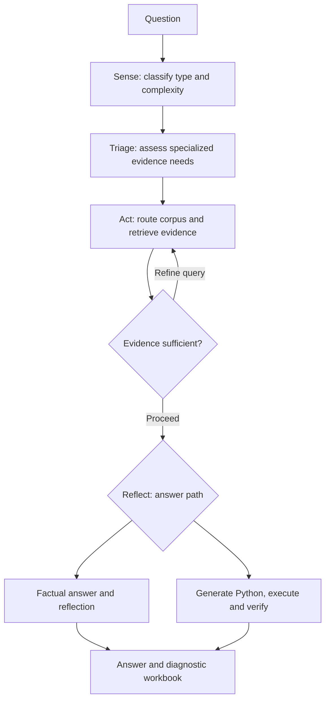

# STAR Agentic RAG: Sense–Triage–Act–Reflect

An agentic retrieval-augmented generation framework for building-science question answering. STAR classifies each question, triages formula/table/figure evidence, routes retrieval across chunking strategies, and generates answers through a reflective factual path or a computational path with Python execution and verification.

Companion code for *From Naive RAG to Agentic RAG: A Multimodal STAR Agentic RAG Framework for Building Science Question Answering* (Saadatnasab et al.).

## Pipeline overview



The diagram summarizes the workflow; retrieval and reflection loops are bounded by the implementation. Specialized modality triage is used on the factual branch. The computational branch uses retrieved evidence to generate code and checks the execution result.

## STAR architecture

| Stage | What it does | Implementation |
|---|---|---|
| **Sense** | Classifies factual/computational intent, complexity, and question format | [pipeline.py](src/star_agentic_rag/pipeline.py), [prompts.py](src/star_agentic_rag/prompts.py) |
| **Triage** | Assesses image, formula, and table evidence and distills useful context | [pipeline.py](src/star_agentic_rag/pipeline.py), [retrieval.py](src/star_agentic_rag/retrieval.py) |
| **Act** | Selects a chunking corpus; retrieves with BM25, dense FAISS, fusion, MMR, and reranking; refines queries | [retrieval.py](src/star_agentic_rag/retrieval.py), [config.py](src/star_agentic_rag/config.py) |
| **Reflect** | Reflects on factual answers or generates Python, executes it, and verifies computational results | [pipeline.py](src/star_agentic_rag/pipeline.py), [sandbox.py](src/star_agentic_rag/sandbox.py) |

## Research workflow

| # | Stage | What it does | Guide |
|---|---|---|---|
| 1 | Chunking | Builds hierarchical, content-type-aware, parent-child, and atomic-block corpora from prepared Markdown | [01_chunking](01_chunking/README.md) |
| 2 | Baselines | Runs no-retrieval LLM inference and single-pass hybrid RAG, with API and Ollama variants | [02_baselines](02_baselines/README.md) |
| 3 | STAR Agentic RAG | Runs the full agentic workflow and records answers and diagnostics | [03_star_agentic_rag](03_star_agentic_rag/README.md) |
| 4 | Evaluation | Judges generated answers against reference answers | [04_evaluation](04_evaluation/README.md) |

Each folder has a README covering its scripts, inputs, commands, and outputs. For the upstream PDF preparation workflow, see the companion [MRP-MSHRAG repository](https://github.com/ssaadatnasab/MRP-MSHRAG).

## Repository structure

```text
.
├── 01_chunking/                  # Four chunking strategies + README
├── 02_baselines/                 # LLM and hybrid RAG scripts + README
├── 03_star_agentic_rag/           # Full inference setup and usage guide
├── 04_evaluation/                # Answer judger + README
├── src/
│   └── star_agentic_rag/         # Installable STAR implementation + module guide
├── tests/                       # Helper tests + testing guide
├── .env.example                 # Provider configuration template
├── pyproject.toml               # Package metadata, dependencies, CLI entry point
├── requirements.txt
├── SECURITY.md
├── LICENSE
└── README.md
```

## Setup

Python 3.10+ is required. Run these commands from a terminal:

```bash
git clone https://github.com/ssaadatnasab/STAR-Agentic-RAG.git
cd STAR-Agentic-RAG
python -m venv .venv
source .venv/bin/activate
# Windows PowerShell: .venv\Scripts\Activate.ps1
python -m pip install -e ".[dev]"
cp .env.example .env
```

Edit `.env` locally with your provider settings, or set the environment variables in your shell. See [the inference guide](03_star_agentic_rag/README.md) for API and Ollama configuration. Chunking scripts may need additional dependencies listed in [their guide](01_chunking/README.md).

## Quick start

Supply a workbook containing `Question` and `Answer` columns and your prepared corpora. Replace `YOUR_MODEL_NAME` with a model served by your endpoint:

```bash
star-agentic-rag \
  --provider openai-compatible \
  --model YOUR_MODEL_NAME \
  --input data/questions.xlsx \
  --output results/answers.xlsx \
  --corpus data/corpora/atomic_block \
  --atomic_block_corpus data/corpora/atomic_block \
  --content_type_aware_corpus data/corpora/content_type_aware \
  --parent_child_corpus data/corpora/parent_child
```

The Python package is `star_agentic_rag`, and the installed command is `star-agentic-rag`. You can also run `python -m star_agentic_rag` with the same arguments. See [the full inference guide](03_star_agentic_rag/README.md) for modality corpora, retrieval settings, checkpoints, and output columns.

## Data and reproducibility

The manuscript describes a knowledge base of 181 textbooks. Textbooks, benchmark workbooks, prepared corpora, model weights, and generated results are not included. Supply data you are authorized to use and record model names and settings for each run. The standalone scripts retain research-environment defaults; provide explicit paths and check their provider configuration before use. The paper's numerical results have not been independently reproduced in this repository setup.

## Development

```bash
python -m pytest
```

See [tests/README.md](tests/README.md) for test scope. Generated-code execution is a subprocess helper with basic checks, not a hardened sandbox; see [SECURITY.md](SECURITY.md).

## Citation

Associated manuscript: **From Naive RAG to Agentic RAG: A Multimodal STAR Agentic RAG Framework for Building Science Question Answering**, Saadatnasab et al. Publication venue and DOI will be added when available.

## License

MIT. See [LICENSE](LICENSE). The code license does not grant rights to external corpora, standards, textbooks, model weights, or datasets.
